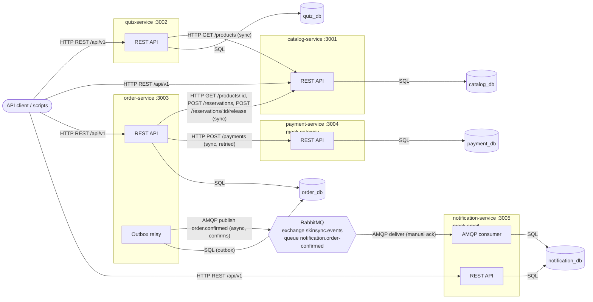
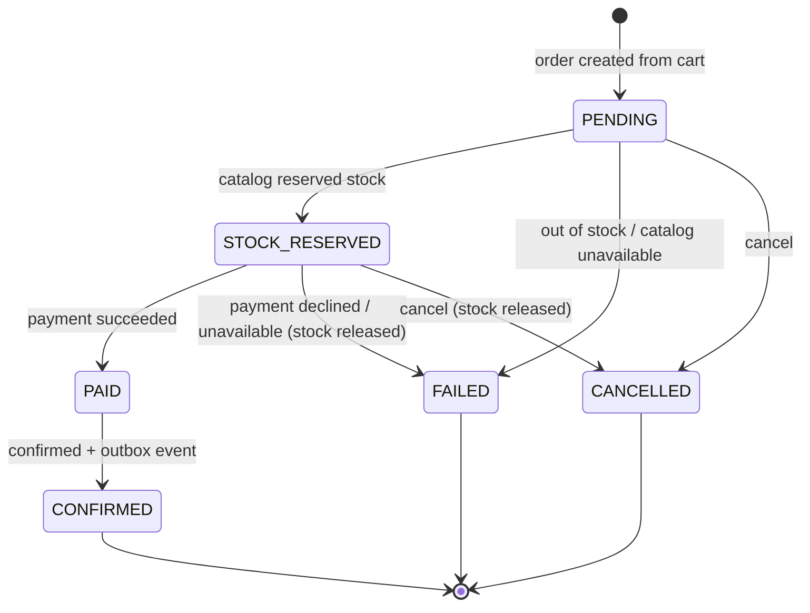
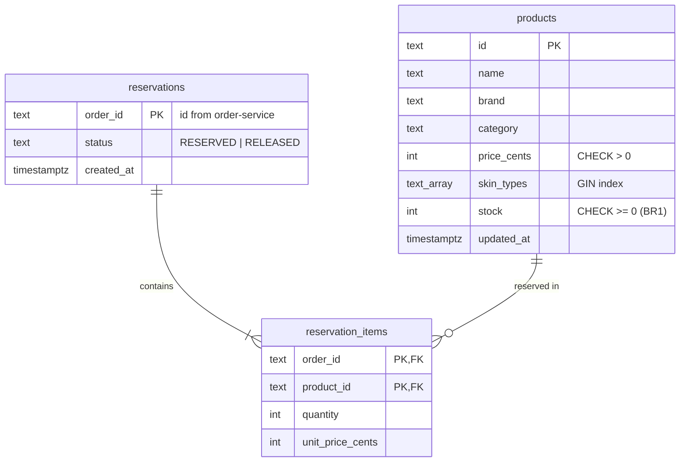
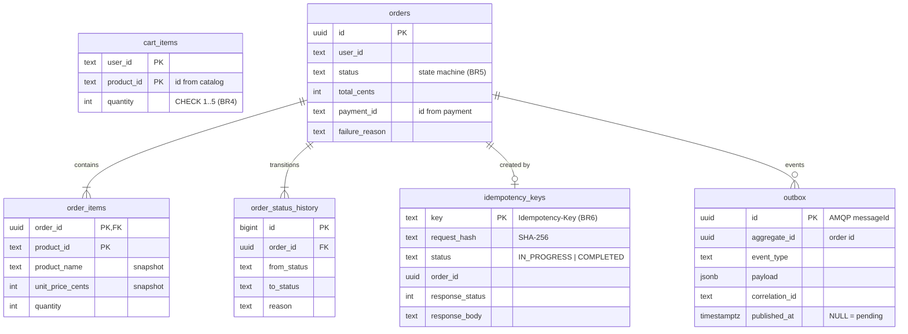
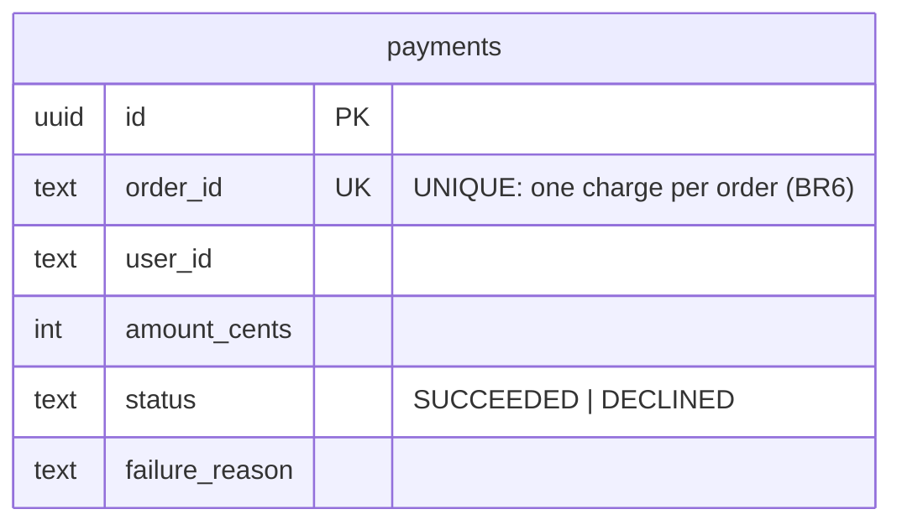
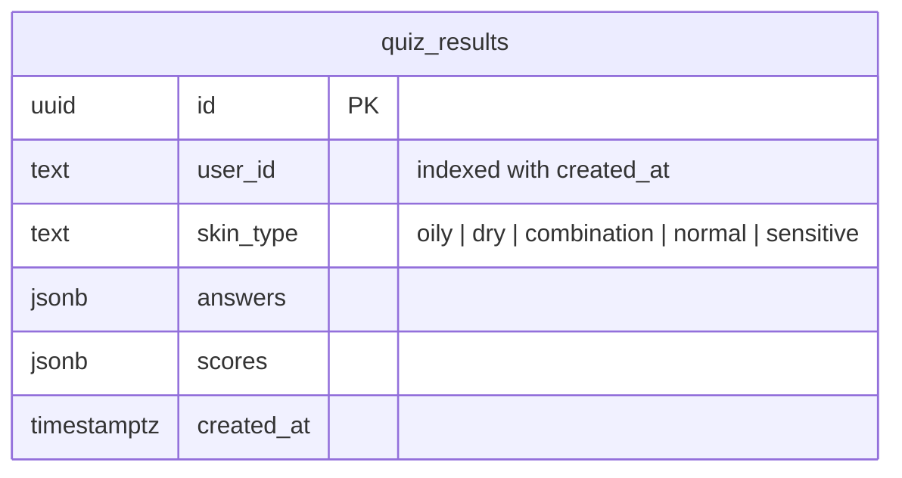
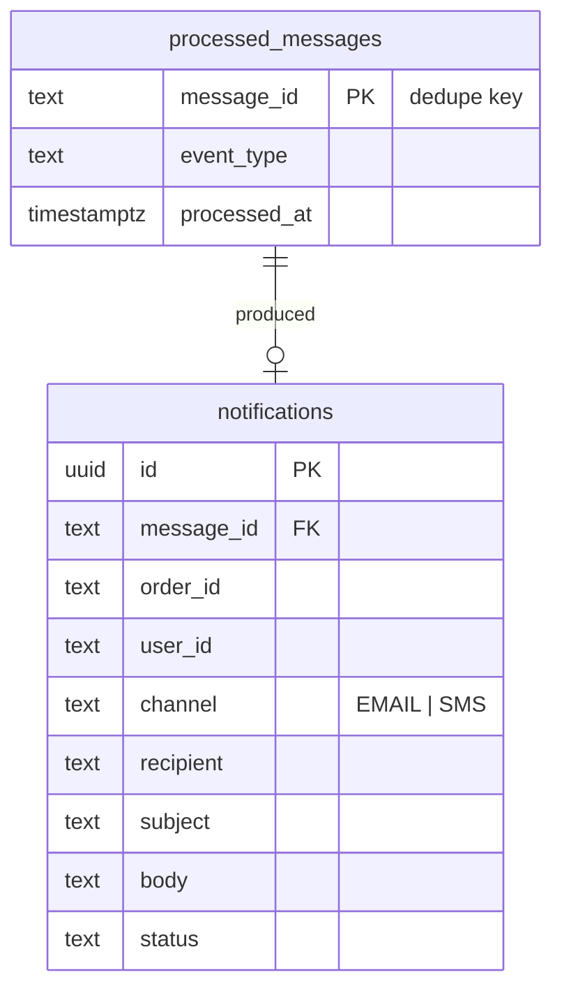

# SkinSync architecture

Diagrams are Mermaid (they render on GitHub and in VS Code). Arrows are labelled with direction and protocol.

## 1. Component diagram



Every service has its own PostgreSQL database **and its own login role**. A role cannot connect to
another service's database (`REVOKE ALL ON DATABASE ... FROM PUBLIC`, see `scripts/db.js`).

The longest synchronous chain is client -> order-service -> catalog-service / payment-service (depth 2).
Notification is asynchronous, so a slow or stopped notification-service never blocks an order.

## 2. Main transaction: place order

### 2a. Happy path

```mermaid
sequenceDiagram
    autonumber
    actor C as Client
    participant O as order-service
    participant ODB as order_db
    participant CAT as catalog-service
    participant P as payment-service
    participant MQ as RabbitMQ
    participant N as notification-service

    C->>O: POST /api/v1/orders {userId}<br/>Idempotency-Key: K (HTTP)
    O->>ODB: INSERT idempotency_keys (K, sha256, IN_PROGRESS)<br/>ON CONFLICT DO NOTHING
    O->>ODB: read cart (BR4: not empty)<br/>INSERT order PENDING
    O->>CAT: POST /api/v1/reservations {orderId, items} (HTTP)
    CAT->>CAT: BEGIN; UPDATE products SET stock = stock - q<br/>WHERE id = ? AND stock >= q (BR1); COMMIT
    CAT-->>O: 201 reservation (+ unit prices)
    O->>ODB: PENDING -> STOCK_RESERVED (BR5), store prices and total
    O->>P: POST /api/v1/payments {orderId, amount} (HTTP, timeout + retry)
    P->>P: INSERT payments ... ON CONFLICT (order_id) DO NOTHING (BR6)
    P-->>O: 201 SUCCEEDED
    O->>ODB: STOCK_RESERVED -> PAID
    O->>ODB: BEGIN; PAID -> CONFIRMED; INSERT outbox(order.confirmed);<br/>clear cart; COMMIT
    O->>ODB: UPDATE idempotency_keys SET COMPLETED, response
    O-->>C: 201 order CONFIRMED (Idempotent-Replayed: false)

    Note over O,MQ: asynchronously, every OUTBOX_POLL_INTERVAL_MS
    O->>ODB: SELECT unpublished outbox rows FOR UPDATE SKIP LOCKED
    O->>MQ: publish (persistent, messageId = outbox.id) (AMQP)
    MQ-->>O: publisher confirm
    O->>ODB: UPDATE outbox SET published_at = now()
    MQ->>N: deliver order.confirmed (AMQP)
    N->>N: BEGIN; INSERT processed_messages(messageId) ON CONFLICT DO NOTHING;<br/>send mock email; INSERT notification; COMMIT
    N-->>MQ: ack
```

### 2b. Failure path: payment declined (compensation)

```mermaid
sequenceDiagram
    autonumber
    actor C as Client
    participant O as order-service
    participant ODB as order_db
    participant CAT as catalog-service
    participant P as payment-service

    C->>O: POST /api/v1/orders {userId}<br/>Idempotency-Key: K2 (HTTP)
    O->>ODB: claim K2, INSERT order PENDING
    O->>CAT: POST /api/v1/reservations (HTTP)
    CAT-->>O: 201 reserved
    O->>ODB: PENDING -> STOCK_RESERVED
    O->>P: POST /api/v1/payments (HTTP)
    P-->>O: 402 PAYMENT_DECLINED
    Note over O: 4xx is not retried (only timeouts / 5xx are)
    O->>CAT: POST /api/v1/reservations/{orderId}/release (HTTP, idempotent)
    CAT->>CAT: UPDATE reservations SET RELEASED WHERE status = 'RESERVED';<br/>stock = stock + q
    CAT-->>O: 200 RELEASED
    O->>ODB: STOCK_RESERVED -> FAILED (reason PAYMENT_DECLINED)
    O->>ODB: store 402 response for K2
    O-->>C: 402 PAYMENT_DECLINED {details.orderId}
```

Other failure paths, all ending in a consistent state:

| Failure | What happens | Client sees |
|---|---|---|
| Not enough stock | catalog UPDATE matches 0 rows, transaction rolled back, order FAILED (OUT_OF_STOCK) | 409 OUT_OF_STOCK |
| catalog-service down / timeout | release attempted (idempotent, in case the reservation committed), order FAILED (CATALOG_UNAVAILABLE) | 503 DEPENDENCY_UNAVAILABLE |
| payment-service down / timeout / 5xx | retried `PAYMENT_MAX_ATTEMPTS` times with exponential backoff and jitter (safe: payment is idempotent per orderId), then stock released and order FAILED | 503 |
| RabbitMQ down | order still CONFIRMED; event stays in the outbox until the relay can publish | 201 |
| notification-service down | messages wait in the durable queue; consumed after restart | 201 |

## 3. Order state machine (BR5)



Enforced in two places: `rules.assertTransition` (allowed edges, unit-tested) and a compare-and-set
`UPDATE orders SET status = $to WHERE id = $id AND status = $from` (protects against concurrent changes).
Any other transition returns **409 ILLEGAL_STATE_TRANSITION**.

## 4. Data design

### Data ownership

| Service | Database / role | Owns | Holds only IDs of |
|---|---|---|---|
| catalog-service | catalog_db / catalog_user | products, stock, reservations | orderId (order-service) |
| quiz-service | quiz_db / quiz_user | quiz results (skin type per user) | userId (external) |
| order-service | order_db / order_user | carts, orders, status history, idempotency keys, outbox | productId (catalog), paymentId (payment), userId |
| payment-service | payment_db / payment_user | payments | orderId (order-service), userId |
| notification-service | notification_db / notification_user | notifications, processed message ids | orderId, userId |

Cross-service references are plain text columns with **no foreign keys**. Data needed from another service
is fetched through its API at the moment it is needed (for example, prices are returned by the catalog
reservation and copied into `order_items` as a snapshot, so later price changes do not alter past orders).

### catalog_db



### order_db



### payment_db



### quiz_db



### notification_db



## 5. Cross-cutting conventions

- **Versioned REST**: every business endpoint is under `/api/v1`. OpenAPI 3 specs live in each
  service folder (`openapi.yaml`, served at `/docs` and `/openapi.yaml`) and are copied to `docs/openapi/`.
- **Error format** (all services):
  `{ "error": { "code": "OUT_OF_STOCK", "message": "...", "details": {...}, "correlationId": "..." } }`
- **Status codes**: 400 malformed input (`VALIDATION_ERROR`, `INVALID_JSON`), 404 unknown resource,
  409 conflicts (`OUT_OF_STOCK`, `ILLEGAL_STATE_TRANSITION`, `REQUEST_IN_PROGRESS`), 422 business-rule
  violations (`EMPTY_CART`, `CART_QUANTITY_OUT_OF_RANGE`, `INCOMPLETE_QUIZ`, `IDEMPOTENCY_KEY_REUSED`),
  402 payment declined, 502/503 dependency failures.
- **Correlation ID**: read from `X-Correlation-Id` or generated, echoed in the response, written in every
  JSON log line, forwarded on outgoing HTTP calls and in the AMQP header `x-correlation-id`.
- **Configuration**: only environment variables (each service's `.env.example` lists them). No service has a
  hard-coded host name, so the same code runs on Docker/Kubernetes in Assignment 2.
- **Health**: `GET /health` returns `UP`, `DEGRADED` (broker down, still 200) or `DOWN` (database down, 503).
